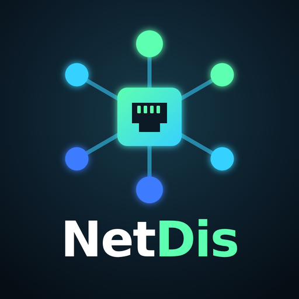
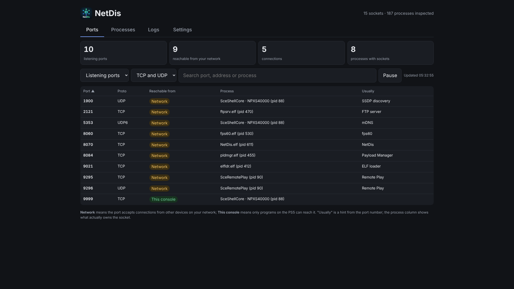
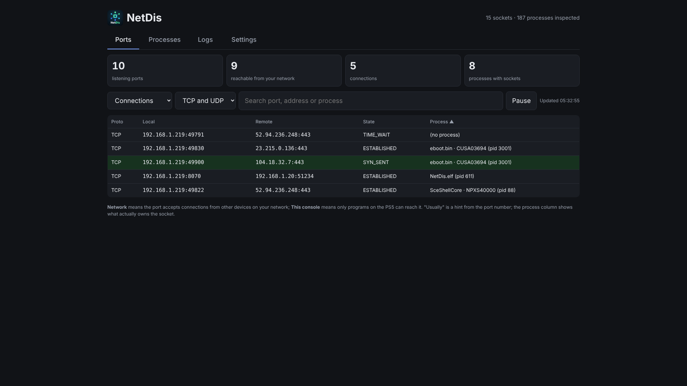
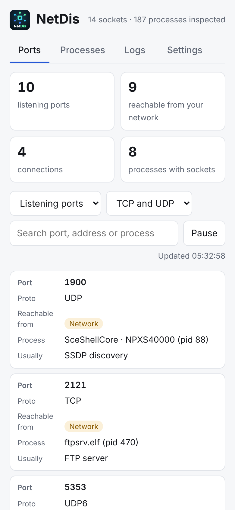
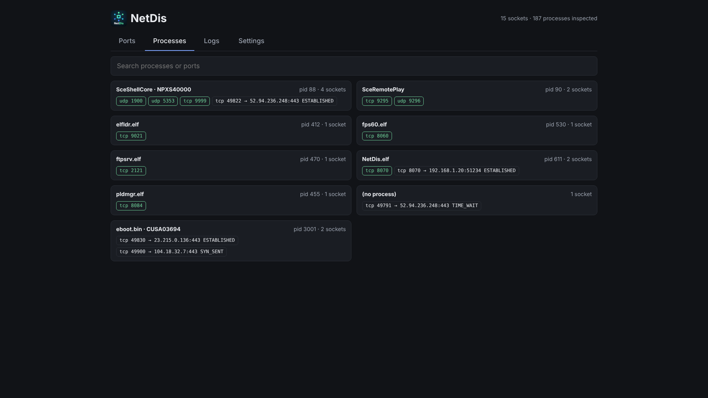
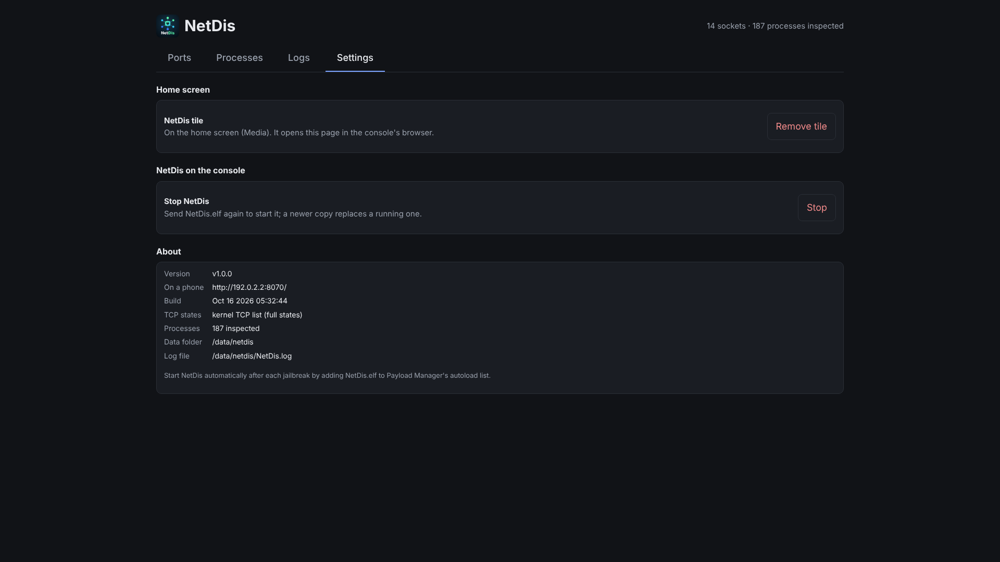
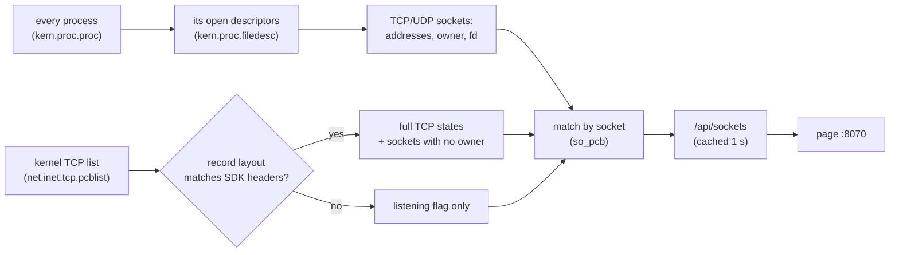

<p align="center"></p>

<h1 align="center">NetDis</h1>

<p align="center">
  See every network port in use on a jailbroken PS5: who owns it, and who can reach it.<br>
  <a href="https://github.com/eladharels/ps5-netdis/releases/latest"></a>
  <a href="https://github.com/eladharels/ps5-netdis/actions/workflows/build.yml"></a>
</p>



NetDis is a payload for a jailbroken PS5. It lists every TCP and UDP socket on
the console: listening ports, open connections, and what is waiting to close.
For each one it shows the process that owns it (and the game's title ID), the
connection state, and whether other devices on your network can reach it.
Everything is on a live page in the console's own browser, or on your phone.

Use it to:

- check which payloads are listening, and whether that's on the network or
  only on the console
- see what a game or the system connects to
- find what holds a port before starting a tool that needs it

> The screenshots in this README come from a test run with sample data on a
> PC, so the page looks exactly as it does on the console.

## Contents

- [What you need](#what-you-need)
- [Quick start](#quick-start)
- [Using NetDis](#using-netdis)
- [How it works](#how-it-works)
- [Files on the console](#files-on-the-console)
- [Limits](#limits)
- [Troubleshooting](#troubleshooting)
- [Versions and releases](#versions-and-releases)
- [Building from source](#building-from-source)
- [Credits](#credits)

## What you need

- A PS5 that is jailbroken and running an **ELF loader** on port `9021`.
  Firmware up to 13.60 works with the Relapse exploit, which provides one.
- A way to send a payload: Payload Manager, the exploit's payload menu, or a
  computer on the same network (`socat` or `make test`).
- Optional: [Payload Manager](https://github.com/itsPLK/ps5-payload-manager),
  to start NetDis automatically after each jailbreak.

## Quick start

1. **Download `NetDis.elf`** from the
   [latest release](https://github.com/eladharels/ps5-netdis/releases/latest)
   (or the zip, which also has this README and the changelog).
2. **Send it to the console** after jailbreaking:
   ```bash
   socat -t 99999999 - TCP:<ps5-ip>:9021 < NetDis.elf
   ```
   or pick it in Payload Manager. The console shows
   *"NetDis v1.0.0 running: http://&lt;ps5-ip&gt;:8070"*.
3. **Open NetDis.** On the home screen, go to **Media** and open the
   **NetDis** tile. It opens the page in the console's browser. On a phone
   or computer on the same network, open `http://<ps5-ip>:8070` instead.

NetDis keeps running until the console restarts or goes into rest mode. Send
it again after a reboot, or add `NetDis.elf` to Payload Manager's autoload
list.

## Using NetDis

### Ports

The **Ports** tab opens on the **listening ports**: everything waiting for
connections. The four numbers at the top count:

- listening ports
- how many of them your network can reach
- open connections
- processes with sockets

Each port shows:

- **Port and protocol:** TCP or UDP, with a `6` for IPv6.
- **Reachable from:**
  - **Network:** bound to every address, so other devices on your home
    network can connect.
  - **This console:** bound to `127.0.0.1` / `::1`, so only programs on the
    PS5 can reach it.
  - **One address:** bound to one specific interface.
- **Process:** the program that owns the socket, its process ID, and the
  game's title ID if a game owns it.
- **Usually:** what normally runs on that port number, such as *ELF loader*
  on 9021 or *Remote Play* on 9295. It's only a hint; the process column is
  the truth.

Switch the view to **Connections** to see what's talking to what:



Connections show the local and remote address and the TCP state:
*ESTABLISHED*, *SYN_SENT* (still connecting), *TIME_WAIT* (closed, waiting
to be cleaned up) and so on. Sockets that no process holds any more appear as
*(no process)*. **All sockets** shows both lists together.

- The page refreshes **every 2 seconds**. New sockets flash green. **Pause**
  freezes the list so you can read it.
- Click a **column header** to sort; click again to reverse.
- **Search** matches ports, addresses, states, process names and title IDs.
- **TCP / UDP** filters by protocol.



On a phone, each socket becomes a card, so nothing is cut off.

<br clear="right">

### Processes



The **Processes** tab groups sockets by program. Listening ports are green;
connections show where they go and their state. Search by process name,
title ID or port.

### Logs and Settings



- **Logs:** what NetDis did, with level and text filters, **Copy** and
  **Download**. **Diagnose** logs every socket found and how the TCP states
  were read.
- **Settings:**
  - remove or reinstall the home screen tile
  - stop NetDis
  - **About**: the address for your phone, the build, which TCP-state mode
    is active (see below), and how many processes were inspected

### Updating and stopping

- **Update:** send the new `NetDis.elf`. It asks the running copy to stop and
  takes its place, and you get *"NetDis restarted"*.
- **Stop:** use **Stop** in Settings, or kill `NetDis.elf` in Payload
  Manager's process list.

## How it works



1. **Who owns what.** NetDis walks every process and reads its open file
   descriptors through `kern.proc.filedesc`, the interface FreeBSD's
   `procstat` uses. For each TCP/UDP socket that gives the local and remote
   address, the descriptor number and the owner. Its layout is a fixed,
   user-facing interface, so this part doesn't depend on Sony's kernel
   internals. The owning game's title ID comes from the system's app info.
2. **TCP states.** The kernel's TCP list (`net.inet.tcp.pcblist`) holds each
   connection's state, but its records embed internal kernel structures that
   Sony may have changed.
   - **Record sizes match the SDK headers:** NetDis reads the full states,
     and also lists closed connections no process holds any more (such as
     *TIME_WAIT*).
   - **They don't match:** NetDis takes only the listening flag, from a part
     it locates and checks first, and leaves other states blank.

   Settings > About shows which mode is active.
3. **The page.** Results are cached for a second, so several open pages share
   one collection. NetDis serves its page on port `8070`. The home screen tile
   is a small media app whose link opens `http://127.0.0.1:8070/` in the
   console's browser.

## Files on the console

| Path | What it is |
| --- | --- |
| `/data/netdis/NetDis.log` | The log of the current run (`NetDis.log.1` is the previous run) |
| `/data/netdis/no-tile` | Present if you removed the home screen tile |
| `/user/app/NETD00001` | The home screen tile |

## Limits

- **Snapshot, not a capture.** NetDis shows which sockets exist; it doesn't
  record traffic. Very short connections can open and close between two
  refreshes.
- **Port hints are guesses.** The *Usually* column is based on the port
  number only.
- **Your network.** NetDis's page is reachable by anything on your home
  network, like the ELF loader. Don't forward these ports to the internet.

## Troubleshooting

| Problem | What to do |
| --- | --- |
| The list is empty | Open **Logs** and press **Diagnose**: it logs how many processes were read and any that failed. |
| TCP states are blank | Settings > About says *listening only*: the kernel's TCP list layout differs on this firmware. Listening ports are still marked; send the Diagnose log to whoever helps you. |
| The tile isn't on the home screen | In **Settings**, press **Install tile**, then filter the log for `tile`. |
| *"port 8070 is busy"* | Another program uses port 8070, or the running NetDis didn't stop. Restart the console. |
| The tile opens an error page | NetDis isn't running. Send `NetDis.elf` again (or add it to Payload Manager's autoload). |

## Versions and releases

Every version is published on the
[Releases page](https://github.com/eladharels/ps5-netdis/releases) with:

- `NetDis.elf`, ready to send to the console
- `NetDis-vX.Y.Z.zip`, which holds the same ELF plus this README and the
  changelog

What changed in each version is in [CHANGELOG.md](CHANGELOG.md) and in each
release's notes. The running version is shown in the start notification and
under Settings > About.

Version numbers follow [semantic versioning](https://semver.org):

- **X:** goes up for changes that break your setup.
- **Y:** goes up for new features.
- **Z:** goes up for fixes.

Publishing a new version (for maintainers):

1. Put the new number in `VERSION`, and add a `## [X.Y.Z] - date` section at
   the top of `CHANGELOG.md`.
2. Merge the change into `main`.
3. Tag the merge commit and push the tag: `git tag vX.Y.Z && git push origin vX.Y.Z`.
4. The *release* workflow checks the tag matches `VERSION`, runs the tests,
   builds with the pinned SDK (v0.44), and publishes the release with the
   changelog section as its notes.

## Building from source

```bash
sudo apt-get install make clang-18 lld-18 llvm-18 wget unzip zip python3 socat
wget https://github.com/ps5-payload-dev/sdk/releases/download/v0.44/ps5-payload-sdk.zip
sudo unzip -d /opt ps5-payload-sdk.zip
export PS5_PAYLOAD_SDK=/opt/ps5-payload-sdk LLVM_CONFIG=/usr/bin/llvm-config-18

make            # NetDis.elf
make check      # host tests: no SDK or console needed
make dist       # build/NetDis-vX.Y.Z.zip
make test PS5_HOST=<ps5-ip>   # send NetDis.elf and stream its log
```

### Tests

`make check` runs on a normal Linux PC with AddressSanitizer and UBSan:

- the socket model: states, reachability, port hints
- the JSON the page reads
- the one-second cache and a failed collection
- the web routes
- a real server test: an idle connection doesn't block other requests, and a
  stop request is answered before the server exits

### CI

GitHub Actions builds `NetDis.elf`, runs the tests and uploads the `NetDis`
artifact on every push and pull request. An optional deploy job sends the
build to your console. It needs a self-hosted runner on your home network,
since GitHub's cloud runners can't reach the console. Configure it with these
repository variables:

| Variable | Default | Meaning |
| --- | --- | --- |
| `PS5_HOST` | unset: deploy skipped | Console IP |
| `PS5_PORT` | `9021` | ELF loader port |
| `PS5_RUNNER` | `ubuntu-24.04` | Runner label for the deploy job |

The repository is public, so before adding a self-hosted runner, set Settings >
Actions > General > *Require approval for all external contributors*.

### Layout

| Folder | Contents |
| --- | --- |
| `netdis/` | Socket collection on the console (`platform_ps5.c`), the socket model and JSON (`sockets.c`), routes and cache (`routes.c`), the page (`ui.html`) and the icon (`assets/`) |
| `common/` | Shared payload framework: web server, log, startup/replace/stop (`service.c`), notifications and home screen tile (`sys_ps5.c`), Logs and Settings tabs (`ui/`) |
| `tools/` | `embed.py`: builds the page and icon into the ELF |
| `.github/workflows/` | `build.yml` (tests and builds every push), `release.yml` (publishes a release for a version tag) |
| `tests/` | Host tests |

## Credits

- [ps5-payload-dev/sdk](https://github.com/ps5-payload-dev/sdk), the PS5
  payload SDK.
- The home screen tile uses the approach introduced by John Törnblom's ftpsrv
  and used by Payload Manager.

Sister project: [fps60](https://github.com/eladharels/ps5-60fps) unlocks
60 FPS in games with a known patch.
